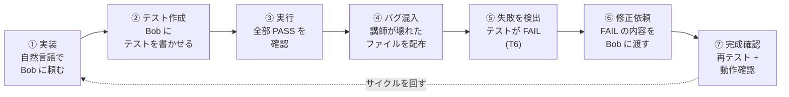
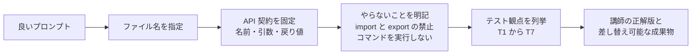
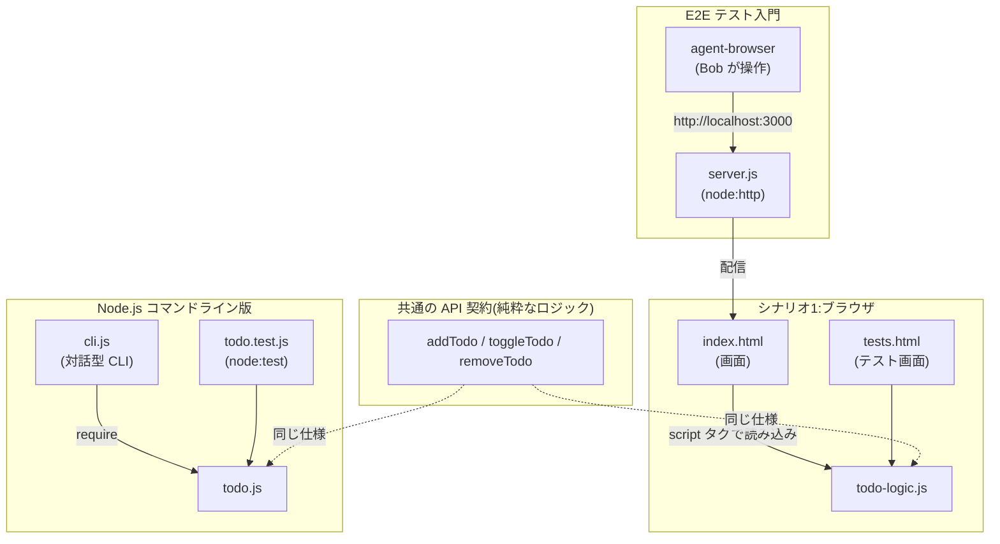
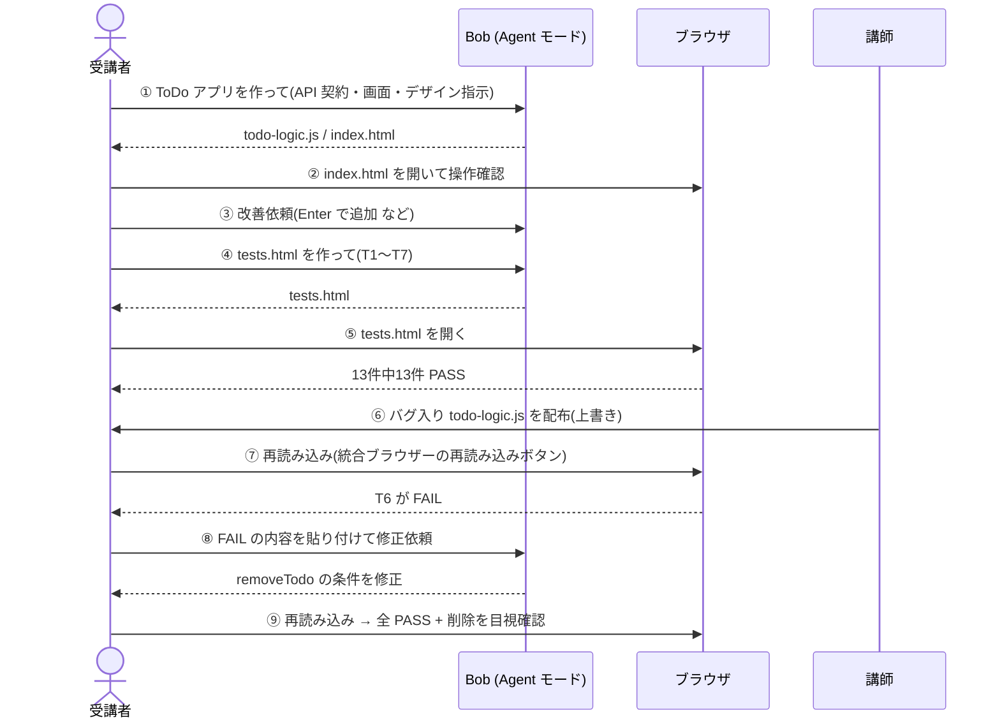
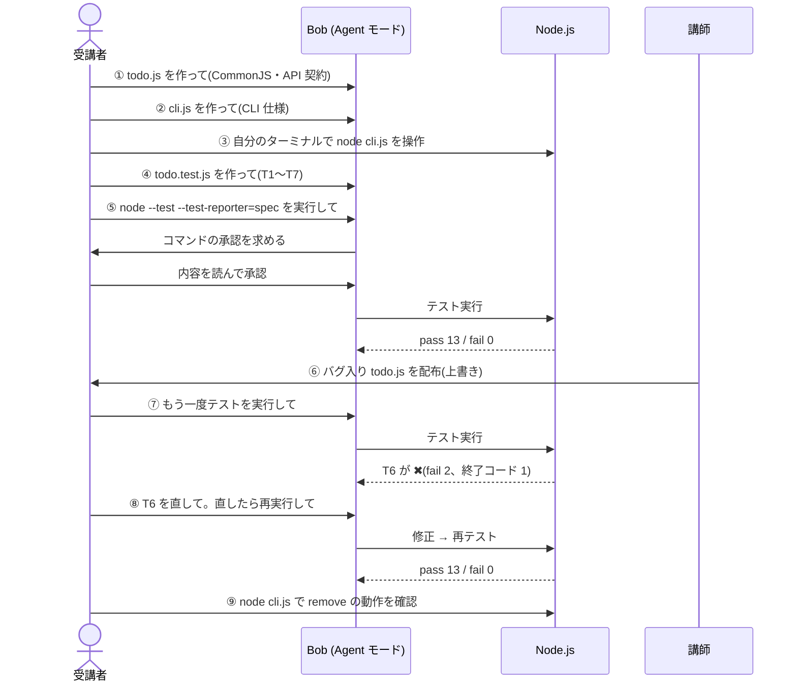
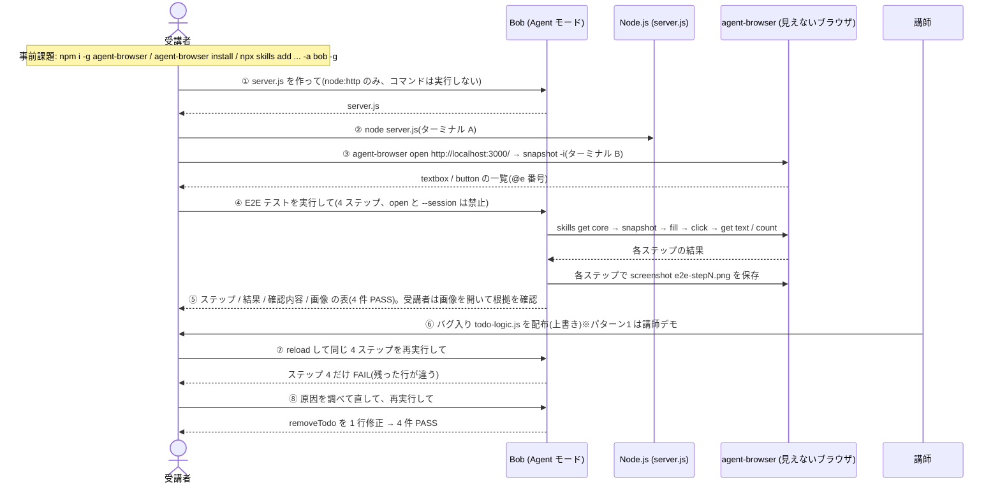
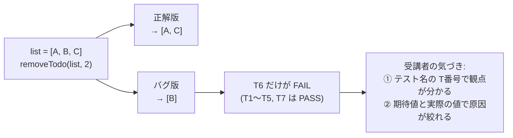
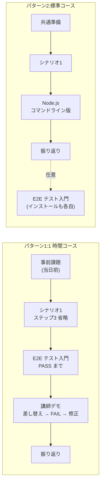

# IBM Bob ハンズオン:Bob で実装し、Bob でテストする

IBM Bob(AI コーディングアシスタント)を使って、**「実装する → テストする → 失敗を直す → 完成を確認する」** という開発の基本サイクルを、**ToDo アプリ**を題材に体験するハンズオンです。

HTML版の教材は [こちら](bobathon-todo.zip)をダウンロードして、展開したフォルダー内の README.html を開いて下さい。

教材は 3 つの演習からできています。すべて同じ題材・同じ関数仕様(API 契約)を使い、違うのは**実行環境とテストの形**だけなので、その違いに集中して学べます。

| | シナリオ1:ブラウザ完結 | Node.js コマンドライン | E2E テスト入門 |
|---|---|---|---|
| 必要なもの | Bob、Chrome または Edge 推奨(Safari/Firefox も可) | Bob、Node.js(脆弱性修正済みの版。[node-setup.md](node-setup.md)) | Bob、Node.js([node-setup.md](node-setup.md))、agent-browser(CLI + スキル)、シナリオ1の成果物 |
| アプリの形 | HTML + JavaScript の画面 | 対話型コマンドライン(CLI) | シナリオ1の画面を Node.js でホスト |
| テストの方法 | `tests.html` をブラウザで開く(ユニットテスト) | `node --test` を **Bob が実行**(ユニットテスト) | **Bob がブラウザを操作**して確認(E2E テスト) |
| 手順書 | [scenario1-browser/guide1.md](scenario1-browser/guide1.md) | [scenario2-nodejs/guide2.md](scenario2-nodejs/guide2.md) | [e2e/guide-e2e.md](e2e/guide-e2e.md) |

受講者の時間と環境に合わせて、2 つのパターンで組み合わせます。

| パターン | 構成 | 所要の目安 | 案内 |
|---|---|---|---|
| **パターン1:1 時間コース** | [事前課題](pre-assignment.md)(当日前)→ シナリオ1(ステップ3 省略)→ E2E テスト入門(PASS と画像の確認まで。バグ差し替えは講師デモ)。Node.js コマンドライン版はオプション | 60 分 + 事前課題 20〜30 分 | [README-pattern1.md](README-pattern1.md) |
| **パターン2:標準コース** | 共通準備 → シナリオ1 → Node.js コマンドライン版 → オプションで E2E テスト入門(インストールも差し替えも各自) | 1〜1.5 時間 + オプション 25〜40 分 | [README-pattern2.md](README-pattern2.md) |

> 準備(Bob のインストール、作業フォルダ、Agent モード、承認の考え方、統合ブラウザー)は [common-setup.md](common-setup.md) に、Node.js の版の確認と更新は [node-setup.md](node-setup.md) に、パターン1 の当日前の準備は [pre-assignment.md](pre-assignment.md) にまとめています。所要時間は作成者の実機確認(2026-10-26 の macOS での通し計測を含む)の 2〜3 倍を見込んだもので、受講者での計測はまだ行っていません。

---

## 1. このハンズオンで学べること



| # | 学べること | 体験する場面 |
|---|---|---|
| 1 | **自然言語の指示で Bob にコードを実装させる** | 関数名・引数・戻り値(API 契約)まで書いたプロンプトで、仕様どおりのコードを得る |
| 2 | **Bob にテストコードを書かせる** | 観点 T1〜T7 を列挙して指示し、網羅的なテストを作らせる |
| 3 | **失敗したテストを読み、Bob に原因調査と修正を頼む** | FAIL の「テスト名・期待値・実際の値」をそのまま渡す |
| 4 | **「完成」を自分で判断する** | 全テスト PASS + 画面/CLI の実操作、の両方で確認する |
| 5 | **Bob を安全に使う** | コマンド実行の承認ダイアログで内容を読んでから承認する(自動承認は使わない)。E2E では最初の承認で「グローバル許可リストに追加 ＋ タスクに対して承認」を行い、終わったら許可リストから外す |
| 6 | **Bob にスキルで道具を覚えさせ、画面を操作するテストを実行させる** | agent-browser のスキルを登録し、Bob が `snapshot` → `fill` → `click` で画面を操作して PASS / FAIL を報告する(E2E テスト入門) |

### プロンプトの書き方が結果を左右する



---

## 2. 共通の題材:ToDo アプリ

タスクの**追加・完了/未完了の切り替え・削除**ができる、メモリ上だけで動く ToDo アプリです。データは次の形です。

```js
{ id: 数値, title: 文字列, done: 真偽値 }
```

ロジックは 3 つの関数だけで、**画面や入出力に依存しない**純粋な関数です(引数の配列は変更せず、新しい配列を返します)。

| 関数 | 振る舞い |
|---|---|
| `addTodo(list, title)` | 前後の空白を除いたタイトルを末尾に追加。`id` は「最大 id + 1」(空配列なら 1)。空/空白のみなら追加しない |
| `toggleTodo(list, id)` | 一致する `id` の `done` を反転。一致なしなら変化なし |
| `removeTodo(list, id)` | 一致する `id` の要素を取り除く。一致なしなら変化なし |

### 同じロジックを、3つの「入口」から使う



### テスト観点 T1〜T7

テスト名は **`T番号: 日本語の説明`** で統一します。FAIL したとき、番号から「どの観点が壊れたか」をすぐ特定できます。

| ID | 観点 |
|---|---|
| T1 | 追加すると件数が 1 増え、`title`・`done:false`・`id` が正しい |
| T2 | 空文字・空白のみは追加されない |
| T3 | 前後の空白が除去される |
| T4 | 切り替えで `done` が `true` になる/存在しない `id` では変化なし |
| T5 | 2 回切り替えると元に戻る |
| T6 | 削除で指定した要素だけが消える/存在しない `id` では何も消えない |
| T7 | 3 関数とも元の配列を変更しない |

---

## 3. シナリオ1:ブラウザだけで ToDo アプリを作る

Node.js は不要です。Bob は**ファイルを書くだけ**で、テストの実行は**受講者がブラウザで開いて**確認します。



### 作るもの

| ファイル | 役割 |
|---|---|
| `todo-logic.js` | ロジック(3 関数。グローバル関数、`import`/`export` なし) |
| `index.html` | 画面(IBM Design Language / Carbon 準拠、IBM Plex Sans JP) |
| `tests.html` | 自作 `test()` / `assertEqual()` によるテスト画面 |

### 実行結果(この README 作成時に実際に実行して確認)

**ToDo アプリの画面** — 追加・完了(取り消し線)・削除・空白のみ無視が動作しました。


**正解版のテスト結果** — 13 件中 13 件 PASS(上部の帯の左端が緑)。テストの件数は Bob の生成結果によって前後します(別の実行では 14 件でした)。


**バグ入りファイルに差し替えたあとのテスト結果** — 13 件中 11 件 PASS。**T6 だけが FAIL** し、期待値と実際の値が表示されます。


> 期待値と実際の値(上の画像)をそのまま Bob に貼り付けると、Bob は「`removeTodo` の条件が逆」という原因にたどり着けます。

---

## 4. Node.js コマンドライン版:Node.js で ToDo アプリを作る

ロジック + 対話型 CLI を作り、**Bob 自身にテストを実行させて**、結果を読ませて直させます。パターン2 ではシナリオ2、パターン1 ではオプションです。



### 作るもの

| ファイル | 役割 |
|---|---|
| `todo.js` | ロジック(CommonJS、`module.exports = { addTodo, toggleTodo, removeTodo }`) |
| `cli.js` | `node:readline` による対話型 CLI(`add` / `list` / `done` / `remove` / `exit`) |
| `todo.test.js` | `node:test` + `node:assert` によるテスト(外部パッケージなし、`package.json` なし) |

### 実行結果(この README 作成時に実際に実行して確認、Node.js v24.22.1)

**① 正解版のテスト** — `node --test --test-reporter=spec`

```text
✔ T1: 空配列に追加すると件数が1増え、id は 1、done は false になる
✔ T1: 既存の要素があれば id は最大 id + 1 になる
✔ T2: 空文字は追加されない
✔ T2: 空白のみは追加されない
✔ T3: 前後の空白は除去される
✔ T4: 切り替えると指定した id の done が true になる
✔ T4: 存在しない id では内容が変わらない
✔ T5: 2回切り替えると done が元に戻る
✔ T6: 削除すると指定した要素だけが消え、ほかは残る
✔ T6: 存在しない id では何も消えない
✔ T7: addTodo は元の配列を変更しない
✔ T7: toggleTodo は元の配列を変更しない
✔ T7: removeTodo は元の配列を変更しない
ℹ tests 13   ℹ pass 13   ℹ fail 0        (終了コード 0)
```

**② CLI の動作** — 次の 12 行を入力すると、手順書の「入出力の例」と一致する応答が得られました。

```text
追加しました: 1: 牛乳を買う
追加しました: 2: レポート
[ ] 1: 牛乳を買う
[ ] 2: レポート
切り替えました: 2
[ ] 1: 牛乳を買う
[x] 2: レポート
id が見つかりません: 9
削除しました: 1
[x] 2: レポート
id が見つかりません: abc
不明なコマンドです: foo
タイトルを入力してください
```

**③ バグ入り `todo.js` に差し替えたあと** — T6 の 2 件だけが失敗し、終了コードは 1 になります。

```text
✔ T1〜T5, T7 …(11 件 PASS)
✖ T6: 削除すると指定した要素だけが消え、ほかは残る
    actual:   [ { id: 2, title: 'B', done: true } ]
    expected: [ { id: 1, title: 'A', done: false }, { id: 3, title: 'C', done: false } ]
✖ T6: 存在しない id では何も消えない
ℹ tests 13   ℹ pass 11   ℹ fail 2        (終了コード 1)
```

**④ 修正後** — 正解版に戻すと `pass 13 / fail 0`(終了コード 0)に復帰しました。

---

## 5. E2E テスト入門:Node.js でホストして、Bob に画面を操作させる

シナリオ1で作った `index.html` と `todo-logic.js` を、Bob に書かせた `server.js`(`node:http` だけ)で `http://localhost:3000` に配り、ブラウザ自動操作 CLI **agent-browser** を Bob の**スキル**として使って、Bob に画面操作のテストをさせます。パターン1 ではシナリオ2(全員)、パターン2 ではオプションです。



### 作るもの・使うもの

| ファイル / 道具 | 役割 |
|---|---|
| `server.js` | `node:http` / `node:fs` / `node:path` だけの静的サーバー(ポート 3000、作業フォルダの外は返さない)。Bob が生成 |
| `~/.bob/skills/agent-browser/SKILL.md` | [skills.sh](https://www.skills.sh/vercel-labs/agent-browser) から `npx skills add vercel-labs/agent-browser --skill agent-browser -a bob -g` で登録するスキル。Bob はこれを読み、最初に `agent-browser skills get core` で最新の使い方を取得してから操作する |
| `agent-browser` | [vercel-labs/agent-browser](https://github.com/vercel-labs/agent-browser)。`npm i -g agent-browser` と `agent-browser install`(Chrome for Testing 約 200 MB)で導入 |

### 実行結果(この節の作成時に実際に実行して確認、Windows 11 / Bob GA 1.126.0 / Node.js v24.22.1 / agent-browser 0.39.2、7 回の試行)

- **正解版**:4 ステップ(要素確認 → 追加 → 追加 → 削除)がすべて PASS。Bob はステップごとに PASS / FAIL・確認内容・画像ファイル名の表を返し、`e2e-step1.png`〜`e2e-step4.png` が作業フォルダに残りました(承認 1 回、E2E の依頼から PASS まで 3 分 30 秒前後)。
- **手順書のステップ1〜8 を通して**(server.js 生成 → 起動 → E2E → 差し替え → 修正 → 後片付け):8 分 19 秒〜9 分 47 秒、承認 3〜4 回。パターン1 の範囲(ステップ1〜5 と 8)は 4〜6.5 分。受講者は 2〜3 倍と見込んでいます。
- **バグ入り `todo-logic.js` に差し替えたあと**:ステップ 1〜3 は PASS、**ステップ 4 だけ FAIL**。Bob の報告は「期待: レポートを書く だけが残る / 実際: 牛乳を買う だけが残り、レポートを書く が消えた」。ユニットテストが「`removeTodo` の戻り値が違う」と教えるのに対し、E2E は**利用者から見た症状**を教えます。
- **修正後**:Bob が `todo-logic.js` を読んで `===` → `!==` の 1 行差分を提示 → 承認 → 再実行で 4 件 PASS に復帰(`fixed-step1.png`〜`fixed-step4.png`)。Bob は保存した PNG を自分で読み取って結果を確かめてから報告することもありました。
- **macOS / Bob Insiders 2.3.0 / Node.js v24.22.1 / agent-browser 0.39.3 / zsh(2026-10-26、通し 1 回)**:正解版 4 ステップ PASS(E2E の依頼から PASS まで 2 分 20 秒、承認 1 回で以降ゼロ)、差し替え後はステップ 4 だけ FAIL、修正後に 4 ステップ PASS(差し替え→修正→PASS で 3 分 37 秒、承認 1 回)。server.js の書き直し、`fill` の失敗、途中の reload はなし。
- **パターン2 の通し(同環境、2026-10-26、差し替え・修正も各自)**:シナリオ1(ステップ3 は例A + 例C)7 分 30 秒・承認 6 回、シナリオ2 7 分 40 秒・承認 8 回、E2E のステップ1〜8 で 6 分 50 秒・承認 3 回(E2E の依頼から PASS の表まで 1 分 20 秒。Bob が `fill`・`click`・`screenshot` を `&&` でつないで一度に実行)。本編(共通準備 + シナリオ1 + シナリオ2)の合計は 17 分 30 秒。

### 実機で分かった設計上のポイント

- **ブラウザを開く(`agent-browser open`)のは受講者**。Bob に実行させると、裏で動き続けるプロセスを Bob の実行ツールが待ち続けて戻ってこないため、プロンプトで `open` と `--session` を禁止し、`reload` を使わせています。
- **Windows(PowerShell)では `@e3` がスプラット構文と解釈され**、そのままだと Bob の最初の `fill` が失敗します(Bob は自分で引用符を付けて再実行します)。プロンプトに「ref は `'@e3'` と単一引用符で囲む」と 1 行書くと、最初から失敗しなくなりました。macOS(zsh)でも同じプロンプトで失敗なしでした。
- **事前課題の確認は、版の表示だけでは足りません**。macOS の実機では、以前に入れた agent-browser 0.28.0 が残っていて `agent-browser --version` は通るのに、`open` が `Auto-launch failed: No running Chrome instance found` で失敗しました。事前課題と当日の確認に `open https://example.com; get title; close` の通過を入れています。
- **`reload` はテスト開始前に 1 回だけ**と書きます。「最初からにしたいときは reload」とだけ書いた回は、Bob がステップ2 の直後に reload して一覧を空に戻し、やり直しが発生しました(Bob 自身が気づいて最初からやり直し、報告に書きました)。
- **Bob の出力には揺れがあります**。server.js を ESM で書いてから CommonJS に書き直して承認が 2 回になる、途中で手順を間違えてやり直す、といった動きは Bob 自身が回復します。手順書には「そのまま待つ」「承認がもう 1 回出ることがある」と書き、講師が事前に伝えます。
- 承認は、最初のダイアログで **グローバル許可/拒否リストに `agent-browser` を追加(✓ が緑になるのを確認)し、続けて「タスクに対して承認」** を押します。実機確認では、この 2 つを最初に行った回は以降の承認が一度も出ませんでした(どちらか片方だけでは 2〜5 回求められた)。許可リストは Bob 全体の設定に残るので、後片付けで外します。
- **E2E の根拠は画像で残します**。Bob に各ステップのあと `agent-browser screenshot e2e-stepN.png` を保存させ、受講者は Bob のエクスプローラーで画像を開いて PASS の根拠を自分の目で確かめます(見えないブラウザの操作結果を可視化)。
- グローバル登録したスキルは **Bob の再起動(またはウィンドウの再読み込み)後**に一覧へ表示されます。事前課題ではその順で確認させています。

---

## 6. バグ演習の仕組み:たった 1 文字の違い

教材のバグは **B1(`removeTodo` の条件が逆)** の 1 種類です。正解版との差は 1 行だけです(`!==` → `===`)。

```diff
 function removeTodo(list, id) {
-  return list.filter((todo) => todo.id !== id);   // 正解:指定 id 以外を残す
+  return list.filter((todo) => todo.id === id);   // バグ:指定 id だけを残す
 }
```



**ポイント**:バグ版にはヒント(コメントなど)を一切入れていません。受講者は**テストの失敗表示だけを手がかりに**原因を探します。また、T7(非破壊の確認)は B1 では FAIL しないよう設計されており、「どの観点が壊れたか」がきれいに切り分けられます。

---

## 7. 3 つの演習から得られる気づき

| 観点 | シナリオ1(ブラウザ) | Node.js コマンドライン | E2E テスト入門 |
|---|---|---|---|
| テストの種類 | ユニットテスト | ユニットテスト | **E2E テスト(画面操作)** |
| テストを実行するのは | 受講者(ブラウザで開く) | **Bob 自身** | **Bob 自身**(見えないブラウザを操作) |
| 失敗の内容を Bob に渡す方法 | 画面からコピーして貼り付ける | Bob が出力を直接読める | Bob が画面の状態を直接読める |
| 失敗から分かること | どの関数の戻り値が違うか | どの関数の戻り値が違うか | **利用者に何が起きるか**(違う行が消える) |
| 繰り返しのしやすさ | 再読み込みで確認 | コマンド 1 つで何度でも | `reload` + 同じ依頼で何度でも(1 回 3〜4 分) |
| 学べる安全面 | ファイルの作成だけを頼む | **コマンド承認ダイアログの読み方** | **許可リストと「タスクに対して承認」の範囲と戻し方**、スキルの登録 |

どの演習でも共通して、次のことが実感できます。

- **テストがあると、目で見るだけでは分からない不具合の場所がすぐ分かる**
- **FAIL の表示をそのまま渡すほど、Bob の修正は的確になる**
- **API 契約を固定すると、Bob の出力を講師の正解版と差し替えられる**

---

## 8. 進め方・前提

- **対象者**:何らかの開発経験がある方(JavaScript 未経験でもコードが読めれば可)。非エンジニアはシナリオ1 を手順どおりに進められる水準で、E2E テスト入門はターミナル操作に慣れている方向け
- **OS**:Windows / macOS(手順書は両対応。E2E テスト入門は Windows 11 / Bob GA と macOS / Bob Insiders 2.3.0 の両方で実機確認済み。受講者は GA 版を使う前提。IBM 社員が使う Insiders 版との画面の違いは [common-setup.md](common-setup.md) の 4 に注記)
- **ブラウザ(シナリオ1)**:Google Chrome または Microsoft Edge 推奨(Safari や Firefox でも動作確認済み)。Bob の統合ブラウザーでも確認できます
- **Bob のモード**:Agent モード。自動承認は Bob設定(チャット > ツール)の既定値で **読み取り(Read)のみ**をオンにし、編集(Edit)・実行(Execute)・MCP の自動承認はオフにします(手順は common-setup.md)
- **Node.js(Node.js コマンドライン版、E2E テスト入門)**:脆弱性が修正された版が必須です。最低ラインは [Node.js の準備(node-setup.md)](node-setup.md)の表を参照してください(満たせない場合は、ペア作業またはシナリオ1に切り替え)
- **MCP / Skills**:MCP は使いません。Skills は E2E テスト入門で agent-browser のスキルを使います(登録は [事前課題](pre-assignment.md)の 5。グローバル登録は Bob を起動し直すまで一覧に出ません)

### 受講の流れ



### パターン1 の時間配分(見込み)

| 時間 | 内容 |
|---|---|
| 0:00〜0:05 | 事前課題の確認(`node -v`、`agent-browser --version` が 0.39 以上、`agent-browser open https://example.com; agent-browser get title; agent-browser close` が通る、Bob設定 > スキル) |
| 0:05〜0:25 | シナリオ1(ステップ3 を省略) |
| 0:25〜0:45 | E2E テスト入門(ステップ5 の全部 PASS と画像の確認まで。終わった人は後片付け。遅れた人を吸収する枠) |
| 0:45〜0:50 | 講師デモ(バグ差し替え → E2E が FAIL → Bob が修正。画像で見せる) |
| 0:50〜1:00 | 振り返り(予備時間を含む) |

2026-10-26 の macOS / Bob Insiders での通し計測(シナリオ1(ステップ3 省略)6 分 41 秒・承認 4 回、E2E のステップ1〜5 と 8 で約 5 分 30 秒・承認 1 回、講師デモ 3 分 37 秒。迷い時間を含まない下限値)の 2〜3 倍をもとにした見込みです(シナリオ1 13〜20 分、E2E 11〜17 分)。初回の Windows GA 計測(シナリオ1 本編 19 分、E2E ステップ1〜5 と 8 で 4〜6.5 分)とも矛盾しません。受講者での計測はまだ行っていないので、初回はパイロットとして所要時間を記録してください。詳しい時間配分と講師の準備は [README-pattern1.md](README-pattern1.md) にあります。パターン2 の見込み(本編 1〜1.5 時間、オプション 25〜40 分)は、2026-10-26 の macOS 通し計測(本編 17 分 30 秒、E2E ステップ1〜8 で 6 分 50 秒)の 2〜3 倍をもとにしています。

## 9. リポジトリ構成

```text
README.md                  本ページ
README.html                本ページ(HTML)
README-pattern1.md         パターン1(1 時間コース)の進め方・時間配分・講師の準備
README-pattern2.md         パターン2(標準コース)の進め方
pre-assignment.md          パターン1 の事前課題(Bob、Node.js、agent-browser、スキルの登録)
common-setup.md            受講者向け共通準備
node-setup.md              Node.js の準備(版の確認・インストール・更新。Node.js コマンドライン版、E2E、事前課題から参照)
bobathon-todo.zip          受講者配布用(bug/ の 2 ファイル + README と各手順書の .md・.html + images/。30 ファイル)
images/                    README 用スクリーンショット(zip にも同梱)
scenario1-browser/
  guide1.md                受講者向け手順書(ステップ3 冒頭にパターン1 向けの注記)
  guide1.html              受講者向け手順書(HTML)
  bug/                     バグ入り todo-logic.js(B1。E2E テスト入門でも使う)
scenario2-nodejs/
  guide2.md                受講者向け手順書(Node.js コマンドライン版)
  guide2.html              受講者向け手順書(HTML)
  bug/                     バグ入り todo.js(B1)
e2e/
  guide-e2e.md             受講者向け手順書(E2E テスト入門。パターン1/2 の違いは本文に明示)
  guide-e2e.html           受講者向け手順書(HTML)
scripts/
  build_html.py            .md から .html を生成(原本は .md)
  make-zip.sh              配布用 zip の作成
```

各 .md はいずれも受講者向けの原本で、.html は `scripts/build_html.py` で生成します。
