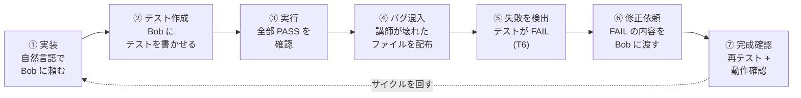
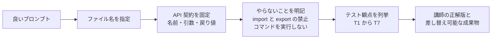
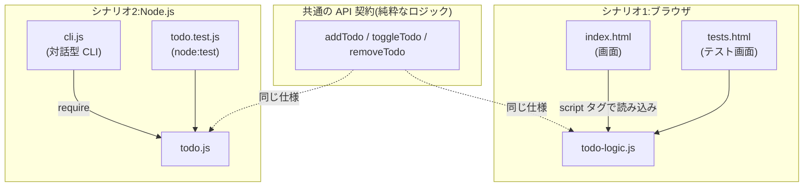
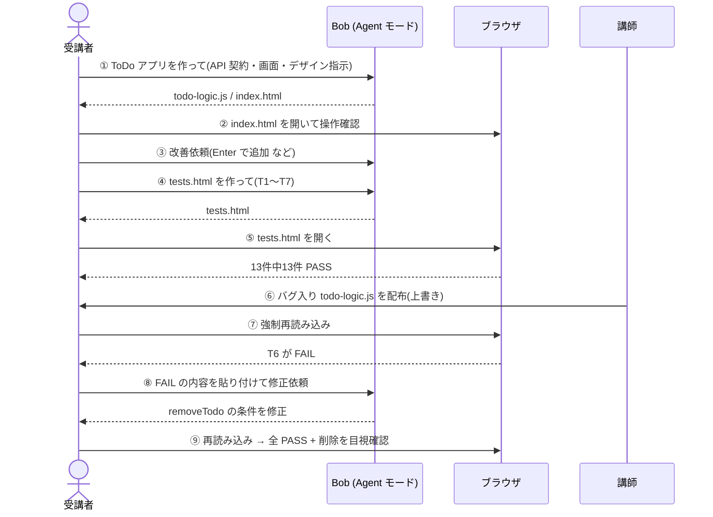
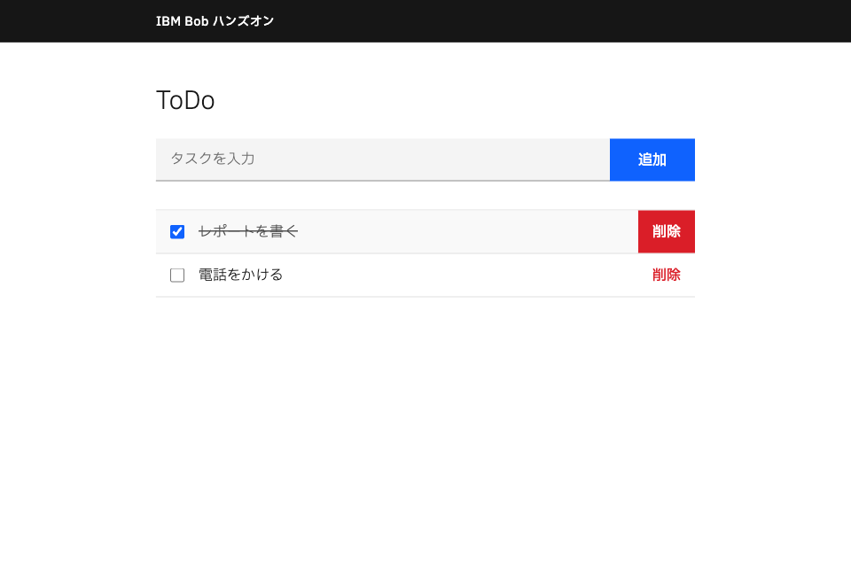
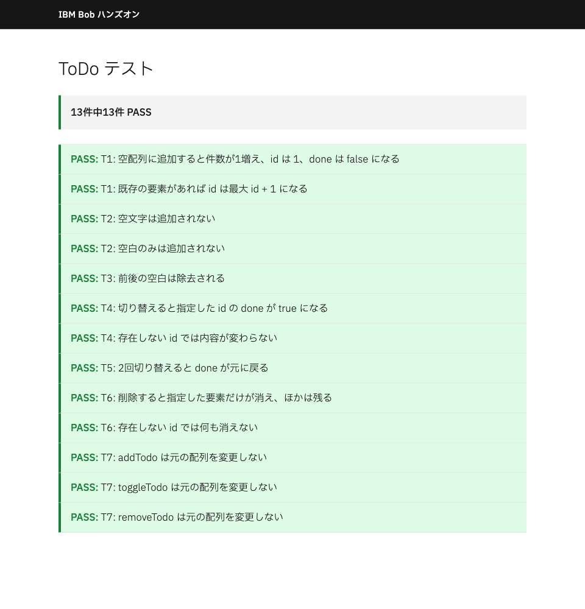
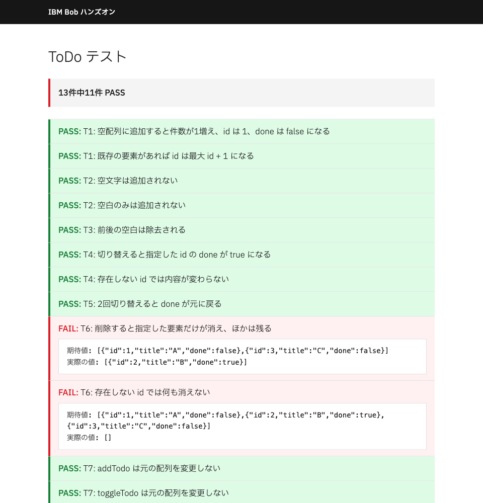
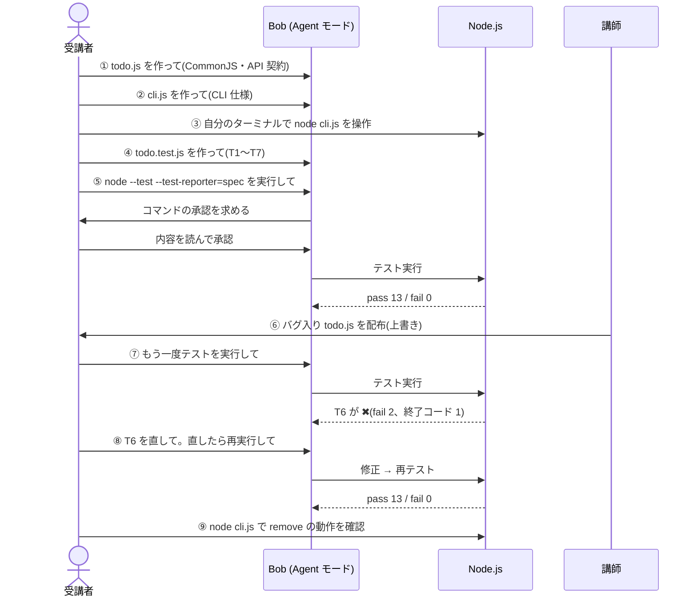
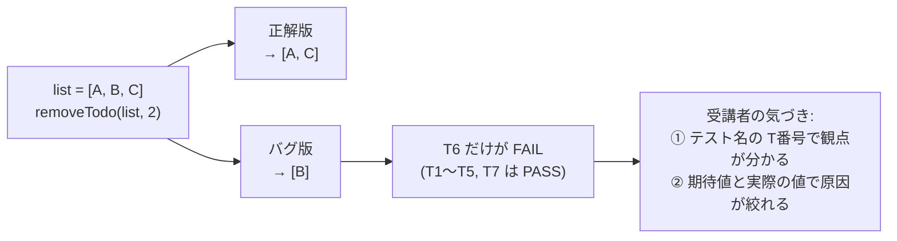
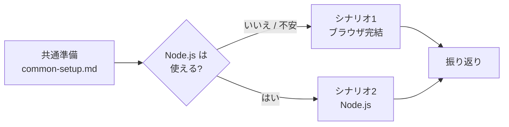

# IBM Bob ハンズオン:Bob で実装し、Bob でテストする

受講者サポート用ファイルは[こちら](bobathon-todo.zip)

* zipファイルを展開したら、bobathon-todoフォルダーが作られるので、IBM Bobを使って、そのフォルダーを開いて下さい。
* なお、boathon-todoフォルダーはダウンロード・フォルダー以外の場所に移動しても大丈夫です。

IBM Bob(AI コーディングアシスタント)を使って、**「実装する → テストする → 失敗を直す → 完成を確認する」** という開発の基本サイクルを、**ToDo アプリ**を題材に体験するハンズオンです。

2つのシナリオは同じ題材・同じ関数仕様(API 契約)を使います。違うのは**実行環境だけ**なので、環境の違いに集中して学べます。

| | シナリオ1:ブラウザ完結 | シナリオ2:Node.js ローカル完結 |
|---|---|---|
| 必要なもの | Bob、Chrome または Edge | Bob、Node.js(脆弱性修正済みの版) |
| アプリの形 | HTML + JavaScript の画面 | 対話型コマンドライン(CLI) |
| テストの方法 | `tests.html` をブラウザで開く | `node --test` を **Bob が実行** |
| 手順書 | [scenario1-browser/guide1.md](scenario1-browser/guide1.md) | [scenario2-nodejs/guide2.md](scenario2-nodejs/guide2.md) |

> 準備(Bob のインストール、作業フォルダ、Agent モード)は [common-setup.md](common-setup.md) にまとめています。

---

## 1. このハンズオンで学べること



| # | 学べること | 体験する場面 |
|---|---|---|
| 1 | **自然言語の指示で Bob にコードを実装させる** | 関数名・引数・戻り値(API 契約)まで書いたプロンプトで、仕様どおりのコードを得る |
| 2 | **Bob にテストコードを書かせる** | 観点 T1〜T7 を列挙して指示し、網羅的なテストを作らせる |
| 3 | **失敗したテストを読み、Bob に原因調査と修正を頼む** | FAIL の「テスト名・期待値・実際の値」をそのまま渡す |
| 4 | **「完成」を自分で判断する** | 全テスト PASS + 画面/CLI の実操作、の両方で確認する |
| 5 | **Bob を安全に使う** | コマンド実行の承認ダイアログで内容を読んでから承認する(自動承認は使わない) |

### プロンプトの書き方が結果を左右する



---

## 2. 共通の題材:ToDo アプリ

タスクの**追加・完了/未完了の切り替え・削除**ができる、メモリ上だけで動く ToDo アプリです。データは次の形です。

```js
{ id: 数値, title: 文字列, done: 真偽値 }
```

ロジックは 3 つの関数だけで、**画面や入出力に依存しない**純粋な関数です(引数の配列は変更せず、新しい配列を返します)。

| 関数 | 振る舞い |
|---|---|
| `addTodo(list, title)` | 前後の空白を除いたタイトルを末尾に追加。`id` は「最大 id + 1」(空配列なら 1)。空/空白のみなら追加しない |
| `toggleTodo(list, id)` | 一致する `id` の `done` を反転。一致なしなら変化なし |
| `removeTodo(list, id)` | 一致する `id` の要素を取り除く。一致なしなら変化なし |

### 同じロジックを、2つの「入口」から使う



### テスト観点 T1〜T7

テスト名は **`T番号: 日本語の説明`** で統一します。FAIL したとき、番号から「どの観点が壊れたか」をすぐ特定できます。

| ID | 観点 |
|---|---|
| T1 | 追加すると件数が 1 増え、`title`・`done:false`・`id` が正しい |
| T2 | 空文字・空白のみは追加されない |
| T3 | 前後の空白が除去される |
| T4 | 切り替えで `done` が `true` になる/存在しない `id` では変化なし |
| T5 | 2 回切り替えると元に戻る |
| T6 | 削除で指定した要素だけが消える/存在しない `id` では何も消えない |
| T7 | 3 関数とも元の配列を変更しない |

---

## 3. シナリオ1:ブラウザだけで ToDo アプリを作る

Node.js は不要です。Bob は**ファイルを書くだけ**で、テストの実行は**受講者がブラウザで開いて**確認します。



### 作るもの

| ファイル | 役割 |
|---|---|
| `todo-logic.js` | ロジック(3 関数。グローバル関数、`import`/`export` なし) |
| `index.html` | 画面(IBM Design Language / Carbon 準拠、IBM Plex Sans JP) |
| `tests.html` | 自作 `test()` / `assertEqual()` によるテスト画面 |

### 実行結果(この README 作成時に実際に実行して確認)

**ToDo アプリの画面** — 追加・完了(取り消し線)・削除・空白のみ無視が動作しました。



**正解版のテスト結果** — 13 件中 13 件 PASS(上部の帯の左端が緑)。



**バグ入りファイルに差し替えたあとのテスト結果** — 13 件中 11 件 PASS。**T6 だけが FAIL** し、期待値と実際の値が表示されます。



> 期待値と実際の値(上の画像)をそのまま Bob に貼り付けると、Bob は「`removeTodo` の条件が逆」という原因にたどり着けます。

---

## 4. シナリオ2:Node.js で ToDo アプリを作る

ロジック + 対話型 CLI を作り、**Bob 自身にテストを実行させて**、結果を読ませて直させます。



### 作るもの

| ファイル | 役割 |
|---|---|
| `todo.js` | ロジック(CommonJS、`module.exports = { addTodo, toggleTodo, removeTodo }`) |
| `cli.js` | `node:readline` による対話型 CLI(`add` / `list` / `done` / `remove` / `exit`) |
| `todo.test.js` | `node:test` + `node:assert` によるテスト(外部パッケージなし、`package.json` なし) |

### 実行結果(この README 作成時に実際に実行して確認、Node.js v24.22.1)

**① 正解版のテスト** — `node --test --test-reporter=spec`

```text
✔ T1: 空配列に追加すると件数が1増え、id は 1、done は false になる
✔ T1: 既存の要素があれば id は最大 id + 1 になる
✔ T2: 空文字は追加されない
✔ T2: 空白のみは追加されない
✔ T3: 前後の空白は除去される
✔ T4: 切り替えると指定した id の done が true になる
✔ T4: 存在しない id では内容が変わらない
✔ T5: 2回切り替えると done が元に戻る
✔ T6: 削除すると指定した要素だけが消え、ほかは残る
✔ T6: 存在しない id では何も消えない
✔ T7: addTodo は元の配列を変更しない
✔ T7: toggleTodo は元の配列を変更しない
✔ T7: removeTodo は元の配列を変更しない
ℹ tests 13   ℹ pass 13   ℹ fail 0        (終了コード 0)
```

**② CLI の動作** — 次の 12 行を入力すると、手順書の「入出力の例」と一致する応答が得られました。

```text
追加しました: 1: 牛乳を買う
追加しました: 2: レポート
[ ] 1: 牛乳を買う
[ ] 2: レポート
切り替えました: 2
[ ] 1: 牛乳を買う
[x] 2: レポート
id が見つかりません: 9
削除しました: 1
[x] 2: レポート
id が見つかりません: abc
不明なコマンドです: foo
タイトルを入力してください
```

**③ バグ入り `todo.js` に差し替えたあと** — T6 の 2 件だけが失敗し、終了コードは 1 になります。

```text
✔ T1〜T5, T7 …(11 件 PASS)
✖ T6: 削除すると指定した要素だけが消え、ほかは残る
    actual:   [ { id: 2, title: 'B', done: true } ]
    expected: [ { id: 1, title: 'A', done: false }, { id: 3, title: 'C', done: false } ]
✖ T6: 存在しない id では何も消えない
ℹ tests 13   ℹ pass 11   ℹ fail 2        (終了コード 1)
```

**④ 修正後** — 正解版に戻すと `pass 13 / fail 0`(終了コード 0)に復帰しました。

---

## 5. バグ演習の仕組み:たった 1 文字の違い

教材のバグは **B1(`removeTodo` の条件が逆)** の 1 種類です。正解版との差は 1 行だけです(`!==` → `===`)。

```diff
 function removeTodo(list, id) {
-  return list.filter((todo) => todo.id !== id);   // 正解:指定 id 以外を残す
+  return list.filter((todo) => todo.id === id);   // バグ:指定 id だけを残す
 }
```



**ポイント**:バグ版にはヒント(コメントなど)を一切入れていません。受講者は**テストの失敗表示だけを手がかりに**原因を探します。また、T7(非破壊の確認)は B1 では FAIL しないよう設計されており、「どの観点が壊れたか」がきれいに切り分けられます。

---

## 6. 2 つのシナリオから得られる気づき

| 観点 | シナリオ1(ブラウザ) | シナリオ2(Node.js) |
|---|---|---|
| テストを実行するのは | 受講者(ブラウザで開く) | **Bob 自身** |
| 失敗の内容を Bob に渡す方法 | 画面からコピーして貼り付ける | Bob が出力を直接読める |
| 繰り返しのしやすさ | 再読み込みで確認 | コマンド 1 つで何度でも |
| 学べる安全面 | ファイルの作成だけを頼む | **コマンド承認ダイアログの読み方** |

どちらでも共通して、次のことが実感できます。

- **テストがあると、目で見るだけでは分からない不具合の場所がすぐ分かる**
- **FAIL の表示をそのまま渡すほど、Bob の修正は的確になる**
- **API 契約を固定すると、Bob の出力を講師の正解版と差し替えられる**

---

## 7. 進め方・前提

- **対象者**:プログラミング経験がある方(JavaScript 未経験でもコードが読めれば可)
- **OS**:Windows / macOS(手順書は両対応)
- **Bob のモード**:Agent モード。自動承認は **Read のみ**にし、Execute(コマンド実行)の自動承認は使いません
- **Node.js(シナリオ2)**:脆弱性が修正された版が必須です。最低ラインは [シナリオ2の手順書](scenario2-nodejs/guide2.md#2-バージョン要件)の表を参照してください(満たせない場合は、ペア作業またはシナリオ1に切り替え)
- **MCP / Skills**:受講者の手順では使いません

### 受講の流れ



## 8. リポジトリ構成

```text
README.md                  本ページ
common-setup.md            受講者向け共通準備
bobathon-todo.zip          受講者配布用(bug/ の 2 ファイル + 各シナリオの手順書 guide1/guide2 と common-setup の .md・.html)
images/                    README 用スクリーンショット
scenario1-browser/
  guide1.md                受講者向け手順書
  guide1.html              受講者向け手順書(HTML)                
  bug/                     バグ入り todo-logic.js(B1)
scenario2-nodejs/
  guide2.md                受講者向け手順書
  guide2.html              受講者向け手順書(HTML)
  bug/                     バグ入り todo.js(B1)
```
